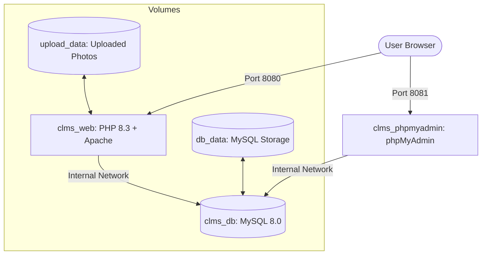

# SLAF CLMS Docker Deployment Setup

This document provides a walkthrough of the Dockerization setup for the **Computer Laboratory Management System (CLMS)**. The project is now fully containerized, enabling single-command startup without requiring local manual installations of PHP, MySQL, Apache, or tools like XAMPP.

---

## 1. Container Architecture Overview

The system consists of three interconnected containers configured within a dedicated Docker network:



### Services & Port Mappings
1. **Application Web Server (`clms_web`)**:
   - **Engine**: PHP 8.3 + Apache
   - **Host Port**: `8080` (accessible via `http://localhost:8080`)
   - **Internal Port**: `80`
2. **Database Server (`clms_db`)**:
   - **Engine**: MySQL 8.0
   - **Host Port**: `3306` (for external database clients, if needed)
   - **Internal Port**: `3306`
3. **Database Administration (`clms_phpmyadmin`)**:
   - **Engine**: phpMyAdmin 5.2
   - **Host Port**: `8081` (accessible via `http://localhost:8081`)
   - **Internal Port**: `80`

---

## 2. Docker Files Generated & Updated

### A. [Dockerfile](file:///c:/xampp/htdocs/Computer%20Laboratory%20Management%20System/Dockerfile)
Built on `php:8.3-apache`, the Dockerfile compiles all requirements and enforces production-ready guidelines:
- **System Packages**: Installs `libpng-dev`, `libjpeg62-turbo-dev`, `libwebp-dev`, `libfreetype6-dev`, `zip`, `unzip`, `git`, and `curl`.
- **PHP Extensions**: Configures and builds the `gd` extension (with Freetype, JPEG, and WebP support) along with `pdo_mysql` and `mysqli`.
- **Production Configuration**: Copies the official production `php.ini` configuration.
- **Apache Rewrite Rules**: Enables `mod_rewrite` and modifies Apache configs to set `AllowOverride All` for the `/var/www/` directory to enable `.htaccess` MVC routing.
- **Security & Permissions**: Recursively updates ownership to `www-data:www-data` and ensures `/var/www/html/uploads` is writable (`775`).

### B. [docker-compose.yml](file:///c:/xampp/htdocs/Computer%20Laboratory%20Management%20System/docker-compose.yml)
Coordinates the startup, networking, volumes, environment configurations, and dependency hierarchy:
- **Dependency Control**: `web` and `phpmyadmin` services use `condition: service_healthy` to wait until the `db` service is fully healthy before starting.
- **Health Checks**:
  - `db`: Pings the server using `mysqladmin ping` authenticated by the environment root password.
  - `web` & `phpmyadmin`: Run HTTP requests using `curl` to check for active port response.
- **Volumes**:
  - `db_data`: Local Docker volume ensuring persistent database storage.
  - `upload_data`: Local Docker volume overlaying `/var/www/html/uploads` to persist photos (e.g., instructor profile photos).

### C. [.env.example](file:///c:/xampp/htdocs/Computer%20Laboratory%20Management%20System/.env.example) & [.env](file:///c:/xampp/htdocs/Computer%20Laboratory%20Management%20System/.env)
Centralizes variables to avoid hardcoded credentials. It defines database credentials (creating a lower-privileged database user `clms_user` for standard application operations instead of root access) and customizable ports for development.

### D. [.dockerignore](file:///c:/xampp/htdocs/Computer%20Laboratory%20Management%20System/.dockerignore)
Ensures local config files (`.env`), database volumes (`db_data/`), repository history (`.git/`), and IDE configurations are not bundled into the built Docker image.

---

## 3. Database Agnostic Seeding

The initialization SQL files [schema.sql](file:///c:/xampp/htdocs/Computer%20Laboratory%20Management%20System/database/schema.sql) and [seed.sql](file:///c:/xampp/htdocs/Computer%20Laboratory%20Management%20System/database/seed.sql) were refactored to remove hardcoded statements:
- Removed: `CREATE DATABASE IF NOT EXISTS slaf_clms;`
- Removed: `USE slaf_clms;`

This allows MySQL to automatically construct and initialize the database name configured via the `MYSQL_DATABASE` env var when booting for the first time, ensuring perfect alignment with the `.env` settings.

---

## 4. Run Instructions

### Prerequisites
Make sure **Docker Desktop** is installed and running on your machine.

### Startup
Open a shell in the root of the project and execute:
```bash
docker compose up -d
```

To watch the initialization and check service health:
```bash
docker compose ps
```

### Shutdown
To stop the application while preserving database and upload data:
```bash
docker compose down
```

To stop the application and wipe database/upload storage (clean restart):
```bash
docker compose down -v
```

---

## 5. Troubleshooting: Docker Desktop Not Started

If running `docker compose up -d` returns:
```text
Error response from daemon: Docker Desktop is unable to start
```

### Solution:
1. Open the **Docker Desktop** application from your Start Menu (Windows) or Applications folder (macOS).
2. Wait for the status indicator at the bottom-left of Docker Desktop to turn green (**Engine Running**).
3. Re-run your command in the terminal:
   ```bash
   docker compose up -d
   ```
