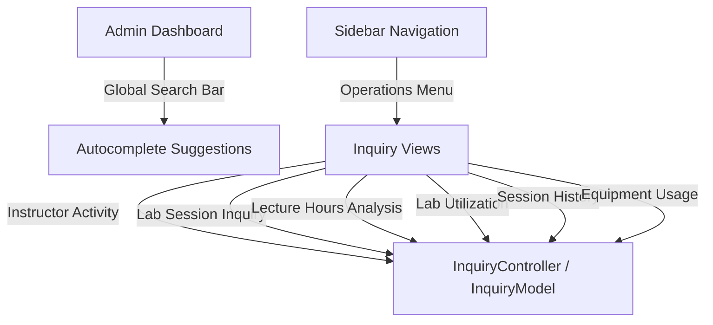

# Advanced Filtering & Operational Inquiry Module

The Advanced Filtering & Operational Inquiry Module has been successfully integrated into the SLAF Computer Laboratory Management System. It provides administrators with a set of real-time dashboards to search, sort, filter, and analyze operational metrics without generating static PDF reports.

## Architecture & Layout

---

## Implemented Modules & Features

### 1. Unified Inquiry Model & Controller
* **`InquiryModel`**: Houses optimized SQL queries with dynamic filter binding to prevent SQL injection. Contains support for:
  * Dynamic date boundaries.
  * Trade, rank, and course filter clauses.
  * Global text matches across multiple database tables.
  * Maintenance records query logs.
* **`InquiryController`**: Maps clean routes (`inquiry/*`) for all 6 dashboards. Integrates role guards (`requireAdmin`), supports hybrid standard HTTP/AJAX output, and aggregates live statistics panels.

### 2. The 6 Interactive Dashboards
1. **Instructor Activity Inquiry (`inquiry/instructorActivity`)**
   * **Filters**: Service No, Name, Rank, Trade, Lab, Lesson, Month, Year, Date Range.
   * **Schedules**: Features a "Calendar" action per instructor that initializes FullCalendar dynamically inside a modal.
   * **Workload Summary**: Live card decks tracking average hours per week/month.

2. **Laboratory Session Inquiry (`inquiry/labSessions`)**
   * **Filters**: Lab, Instructor Name, Trade, Lesson, Date Range.
   * **Metrics**: Total sessions, total hours used, and unique instructor count.

3. **Lecture Hours Analysis (`inquiry/lectureHours`)**
   * **Visualizations**: Integrates a **Bar Chart** showing the *Top 10 Most Active Instructors* and a **Line Chart** mapping the *Monthly Teaching Hours Trend*.
   * **Breakdown**: Displays automated estimates for theory lecture hours vs. practical lab hours.

4. **Laboratory Utilization (`inquiry/labUtilization`)**
   * **Metrics**: Live Available Hours calculation, occupancy rate, and utilization percentage progress indicators.
   * **Visualizations**: Interactive **Daily Usage Line Chart** and a **Peak Timeslots occupancy meter**.

5. **Session History (`inquiry/sessionHistory`)**
   * **Tracking**: Status classification badges (`Scheduled`, `Today`, `Completed`).
   * **Filters**: Comprehensive service, rank, status, and timeline range filters.

6. **Equipment Usage Inquiry (`inquiry/equipmentUsage`)**
   * **Tracking**: Inventory usage statistics.
   * **Interactive Logs**: Click "Maintenance Logs" to fetch full maintenance records for the specific asset dynamically via AJAX.

### 3. Smart Filtering & Live Autocomplete Global Search
* **Saved & Quick Filters**: Provides instant links for quick timeline selections: **Today**, **This Week**, **This Month**, **Last Month**, **This Quarter**.
* **Global Search Box**: Placed directly inside the Administrator Dashboard. Features:
  * 250ms debounced input to prevent database overload.
  * Categorized autocomplete dropdown (Instructors, Laboratories, Lessons, Computers).
  * Direct navigational deep links.

---

## Testing & Verification
You can access all the pages from the **Operations** section in the admin sidebar. Try out these workflows:
1. **Quick Timelines**: Go to *Session History*, click *This Month* under the filters, and verify that the metrics update immediately.
2. **Export data**: Click **Export Selected Results / Export Data** on any page to generate a clean `.csv` spreadsheet locally.
3. **Live Search**: Go to the *Admin Dashboard* and type an instructor's name or asset number into the Global Search bar.
